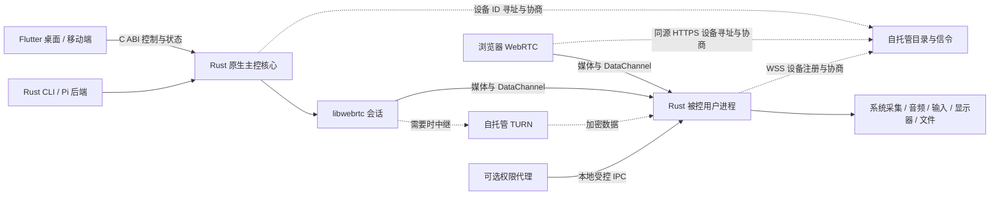

# NexDesk 技术架构

当前工程包括桌面 LAN 协作、自托管设备 ID、浏览器主控、独立终端和 Pi 扩展。发布教程见[各端运行与打包](build.md)和[自托管部署](deployment.md)。

## 技术选型

| 层 | 技术 | 决策依据 |
| --- | --- | --- |
| 领域核心和服务 | Rust，异步 I/O 使用 Tokio | 类型化状态、显式资源所有权，支持桌面、CLI、服务端共用规则 |
| 桌面和移动界面 | Flutter / Dart，`dart:ffi` 调用 Rust，平台纹理呈现视频 | Flutter 复用界面；原生编码、解码、呈现分别按系统验证 |
| 浏览器 | TypeScript / React，原生 `RTCPeerConnection`、`<video>` | 可自托管的标准 Web 媒体与输入通道 |
| 原生媒体 | 固定源码版本的 libwebrtc，C++ 适配经 C ABI 进入 Rust | 成熟的媒体调度、拥塞控制、重传、抖动处理和浏览器互通 |
| 编解码 | H.264 硬件优先、AV1 可选、VP8 兼容，音频使用 Opus | 双方按实际支持的编解码格式协商。会话统计显示当前使用的编码器、解码器和收发尺寸 |
| 业务消息 | Protobuf，Rust 端用 prost | 媒体协商完成后在 WebRTC DataChannel 交换版本化消息，有界解析 |
| 信令和中继 | Rust / Axum + HTTPS/WSS，coturn，部署自带配置 | ID 寻址和跨网路径可自托管，LAN 使用本地入口 |
| 存储 | 跨平台 SQLite 和系统凭据存储 | SQLite 持久化配置和任务；密码、私钥和长期令牌进入凭据库 |
| 终端 | Rust CLI + Crossterm，ANSI / Kitty / Sixel，Pi 扩展使用 TypeScript | 原生核心和终端渲染可独立构建。Pi 通过本地子进程承载会话 |

Flutter 的纹理接口允许原生更新触发显示。零拷贝取决于设备、图形资源格式及各平台插件。libwebrtc 工厂接口允许注入系统编解码实现，需按固定版本构建与验证。[Flutter Texture](https://api.flutter.dev/flutter/widgets/Texture-class.html) · [WebRTC 原生构建](https://webrtc.github.io/webrtc-org/native-code/development/) · [编码器工厂](https://webrtc.googlesource.com/src/+/refs/heads/main/api/video_codecs/video_encoder_factory.h) · [WebRTC 视频要求](https://www.rfc-editor.org/rfc/rfc7742)

## 运行时与边界



- **原生主控核心**负责认证、连接、会话状态、输入映射和任务调度。桌面 UI、CLI、移动端各自处理呈现与输入来源。
- **被控用户进程**驻留已登录用户会话，接收连接并执行权限策略，调用采集、输入、显示器、剪贴板和文件适配。托盘报告真实活跃会话。退出 GUI 以后能否保留此进程由用户设置决定。
- **可选系统代理**仅处理确实需要的启动、会话切换和受授权系统操作。Windows 普通服务与用户桌面分开。各平台先支持已登录的普通桌面，登录前、锁屏、UAC、安全桌面和无显示器各自验证。用户会话进程与代理通过限制当前会话或用户的命名管道/Unix 域套接字通信，校验对端身份，限制消息及权限种类。[Windows 交互服务说明](https://learn.microsoft.com/en-us/windows/win32/services/interactive-services)
- **目录和信令**负责注册、寻址、上线状态、转发协商与发放中继短时凭据。TURN 转发加密包；正常路径不经过媒体服务器转码。

## 代码组织

| 目录 | 职责 | 状态 |
| --- | --- | --- |
| `crates/nexdesk-core` | 领域类型、地址验证，逐步扩展到会话和能力规则 | M0 已建立 |
| `crates/nexdesk-ffi` | 面向 Flutter 的 C ABI，参数校验、会话与帧所有权 | M3 协作命令、异步结果、文件任务、兼容 M2 |
| `apps/desktop` | Flutter 三平台入口、NexDesk 自有界面 | M3 逐项授权、媒体与显示选项、剪贴板和双栏文件 |
| `apps/cli` | 独立 Rust 主控、终端图形、键鼠、授权 Shell | M5 |
| `crates/nexdesk-session` | OPAQUE 认证、直连协商与 Protobuf 控制消息 | M3 分项能力、有界协作协议和恢复权限 |
| `native/windows`、`crates/nexdesk-media` | 固定版 libwebrtc 绑定、采集、编解码及指标 | M3 系统音频、实时质量设置与统计 |
| `apps/agent` | 被控进程、所选来源、回环浏览器邀请 | M3 能力仲裁、文件服务和显示模式事务 |
| `crates/nexdesk-platform` | 系统权限与原生 API 适配 | 键鼠、Unicode 文本、剪贴板、音频和显示模式 |
| `crates/nexdesk-files` | 根目录句柄、清单、文件指纹和接收提交 | 分块续传、SHA-256 校验、同目录提交 |
| `crates/nexdesk-store` | 配置、历史、分辨率与凭据库接口 | 监听偏好、系统凭据、授权目录和分辨率记忆 |
| `crates/nexdesk-directory` | 目录来源、ICE 配置、注册与协商消息、原生客户端 | M4 |
| `apps/signaling`、`apps/web`、`deploy/` | 自托管目录、同源浏览器入口、部署模板 | M4 |
| `extensions/pi` | Pi TUI 与本地 CLI 的对接 | M5 |

应用依赖下层，不反向依赖 Flutter、浏览器、CLI 或系统代理。Cargo workspace 统一依赖与锁定版本。领域模块只表达规则和状态，系统调用位于平台适配，协议消息映射成领域请求后再由主机检查权限。[Cargo Workspace](https://doc.rust-lang.org/cargo/reference/workspaces.html)

## 连接与身份

### 局域网直连

1. 被控方主动启用选定接口的监听，展示其 IP 和入口端口。第一次配置需要本机确认。
2. 主控填入 IP、端口。入口用有界 TCP 协议承载认证及协商，超时、失败次数和并发握手有限额。
3. 认证和信任核对成功后，在端到端受保护的协商通道交换候选地址、会话参数、指纹及能力；ICE 使用局域网可达的候选地址。
4. M2 以一个可配置 TCP 入口和可管理的媒体 UDP 策略交付。固定 UDP 端口或单端口复用取决于 M1 验证；防火墙说明列出实际所需端口。LAN 直连测试关闭公共 STUN/TURN、信令、DNS 及公网出口。

运行中改端口先试绑定，成功才替换设置和新连接入口。关闭接收时释放监听和对应会话。IPv6 分开处理地址和端口，作用域接口由平台解析；M0 支持裸 IPv6 和方括号包裹的 IPv6，不接收作用域字段。完整端口范围为 1–65535。

### 设备 ID 和浏览器

原生和 Web 主控均按“服务器来源 + 设备 ID”寻址。ID 保留前导零，用字符串表示。长连接使用 WSS，主机注册请求绑定其设备身份。服务器转发短期连接事务，由两端验证对端身份。ICE 优先直连，TURN 作为跨网备用。令牌和中继凭据按会话目标、用途和期限发放。隔离网络由内网 HTTPS 同源入口提供页面、API 和信令，证书在控制端受信任。发布的 Web 前端代码属于浏览器主控的信任边界。[WebRTC 规范](https://www.w3.org/TR/webrtc/) · [coturn](https://github.com/coturn/coturn) · [浏览器本地网络访问说明](https://github.com/WICG/local-network-access/blob/main/explainer.md)

最小部署由一个 HTTPS 入口、一个信令实例和按需启用的 TURN 组成。服务持久化设备注册、公钥、配额和撤销记录；在线状态、握手协商和临时路由随连接过期。单节点阶段使用 SQLite，通过脱敏日志和健康端点观测服务，规模扩大后按实际吞吐需求评估数据库或状态协调方案。

### 认证与授权

六位密码通过成熟 PAKE 实现完成双向身份验证，M1 优先评估 RFC 9807 OPAQUE。被控方在本机设置/轮换密码并生成相应认证记录，接入方通过协议证明持有密码。首连需确认设备身份；后续匹配已信任公钥或执行重新配对。LAN 与 ID 按模式分开保存认证配置。

M1 的协议审查须明确验证过的库版本、密钥确认、端到端信令保护、角色与会话上下文绑定、握手时限和限速。锁定对端静态身份，认证双方 SDP/DTLS 指纹及会话授权。审核必须覆盖信令转发方、设备身份更换、强制重放和版本降级。短码的在线尝试按设备、来源和全局预算分别限制。加密方案在验证后写成协议决策记录。[OPAQUE RFC 9807](https://www.rfc-editor.org/rfc/rfc9807.html)

主机端职责按先后为认证、授权、资源创建。每条敏感消息检查当前会话、能力、资源范围和输入租约。撤销更改能力代数，拒绝旧代数的消息。认证失败、超时和降级路径关闭相应会话；新会话不得沿用旧授权。

### 会话状态

```text
空闲 → 寻址/连接 → 身份验证 → 待授权 → 媒体协商 → 已连接
                                               ↓
                        已连接 ← 恢复协商 ← 暂时中断
任何有连接资源的状态 → 关闭中 → 已结束 / 失败
```

会话拥有任务取消、媒体句柄、输入租约和超时。只有有效授权且媒体与控制通道就绪后显示连接成功。恢复同一会话要验证对端和原授权；重新建立的会话获得新 ID 和租约。按操作区分暂时失败、权限拒绝、认证错误、地址不可达、版本不兼容和本地能力缺失。重试不自动重复非幂等的写入、覆盖和授权。

## 协议、输入与文件

M3 经 `/m3/pair/start` 与 `/m3/pair/finish` 认证协商 SDP 和能力。键鼠控制、协作请求和文件数据各用有序 WebRTC DataChannel。协作和文件使用带版本、请求编号和长度上限的 Protobuf 封包。文件分块走独立的有界异步处理队列，目录扫描和校验移到阻塞线程池，交互通道与文件限速分别控制。原生客户端可回退到仍提供 M2 握手的被控端。

文件服务每次请求检查会话授权。主控和被控分别持有各自选定的根目录句柄，从根目录逐级打开相对路径。未确认的接收数据写入目标目录内专用临时文件，校验后以重名策略提交。短时异常断开可在原有效授权中核对源指纹并续传。撤销会话或改变授权目录后，旧会话的传输能力失效。

| 数据 | 传输与调度 |
| --- | --- |
| 视频 / 音频 | WebRTC 媒体轨道，H.264 或 VP8、Opus；RTCP 反馈驱动恢复和自适应 |
| 会话与按键 | 可靠有序 DataChannel，键/按钮状态带输入租约和屏幕代数 |
| 指针移动 | 低时延可丢弃通道，按序号保留最新坐标；点击携带位置和屏幕代数 |
| 剪贴板 | 可靠，带来源和序列，按限额接收文本，允许关闭同步 |
| 文件目录、任务与块 | 可靠，文件控制和数据分开，有界块、发送背压和并发配额 |
| 可选 Shell | 独立权限、独立 PTY 和可靠会话流，显式开启和终止 |

消息封装包含协议主/次版本、会话 ID、请求 ID、操作类型和有限负载。请求 ID 用于超时、配对响应和必要的幂等控制；服务端状态始终权威。新旧两版协商出共同能力，删除的 Protobuf 字段保留编号。接收端在解码前限制帧长度，在解码后验证重复字段、字符串、批大小和权限。不同 DataChannel 仍共享网络资源，文件流量使用应用层预算和 `bufferedAmount` 背压。[WebRTC DataChannel](https://www.rfc-editor.org/rfc/rfc8831.html)

输入使用屏幕标识、屏幕代数和版本化的归一化坐标。主控计算可见画面区域和视口，主机将其映射为原生坐标。焦点、分辨率、屏幕、控制权和连接变化会释放会话持有的按键；看屏、键鼠和 Shell 有独立授权。浏览器遇到系统保留键时使用快捷键操作入口并受主机能力限制。

文件目录请求使用受限根标识和相对路径。逐层按句柄验证根目录，明确链接、重解析点和大小写冲突策略。数据块大小受双方宣布的消息上限和网络预算约束，初始 16 KiB。任务保存传输 ID、源标识、相对路径、目标、提交策略和已确认范围，完成后作端到端校验，再在目标目录内原子提交。文件内容流式读取，取消和空间不足有可回收的临时文件。支持该能力的 Web 浏览器在用户选定目录后显示本机侧，其余走选择上传和下载。[浏览器文件访问](https://developer.chrome.com/docs/capabilities/web-apis/file-system-access)

## 媒体、显示器与平台适配

桌面 SDR 采集使用 BGRA。需要限制传输尺寸时，在复用的工作缓冲区中缩小 RGB 图像，再转换为视频范围的 BT.601 NV12。文字清晰模式对亮度做有界的笔画增强，使用相邻两行工作区，保留平坦色块和色度值。文字模式优先保留分辨率，流畅模式优先保留帧率。在 30 FPS 下，720p、1080p、1440p、2160p 的文字模式自动码率上限分别为 8、16、24、48 Mbps，流畅模式分别为 6、10、16、32 Mbps。显式码率上限优先。切换显示器后按新源尺寸重新计算。实际发送码率由 WebRTC 拥塞控制决定。

进入或退出文字清晰模式，或在文字模式提高已知的码率上限时，被控端等待新设置处理的采集帧，再刷新当前视频编码的帧间参考。这样停在文档上的主控端也能收到更新后的笔画。重复应用相同参数会保留当前编码状态。

macOS 接收端读取 VideoToolbox 像素缓冲区的像素格式和颜色矩阵附件。对于 8 位双平面 SDR，按实际全范围或视频范围还原 RGB。缺少矩阵标签时采用采集端使用的 BT.601。Flutter 直接将帧写入可复用的 BGRA IOSurface，终端和 C ABI 按需取得 RGBA。桌面软件解码器交付的 NV12、I422 和 I444 可按原采样转换。目前桌面 H.264 和 AV1 常规发送链路为 4:2:0。

桌面和浏览器的原始像素模式按解码尺寸和本机显示倍率计算。输入映射使用实际视频绘制区域，独立于传输尺寸上限。视频协商保留所选主负载对应的 RTX 负载和 RTCP 反馈。会话统计将最近一帧的转换与缩放、提交媒体引擎的耗时分别记录，编解码耗时由 WebRTC 独立统计。采集回调之前的操作系统等待时间未计入这两项。

```text
被控显示器 → 平台图像句柄 → 有界帧队列 → 转换 / 缩放 → 硬件编码
            → WebRTC 发送与拥塞控制 → WebRTC 接收 → 硬件解码 → 纹理 / 终端显示
```

| 平台 | 采集、输入与显示 | 编解码及系统声 |
| --- | --- | --- |
| Windows | DXGI Desktop Duplication，必要时 Windows Graphics Capture；Win32 输入与 DisplayConfig，Rust `windows` bindings | D3D11 与 Media Foundation 硬件路径，WASAPI Loopback |
| macOS | ScreenCaptureKit，CoreGraphics 与辅助功能授权，Rust bindings 优先；AppKit 或复杂回调必要时使用 Swift/Objective-C 桥接 | VideoToolbox、CVPixelBuffer，ScreenCaptureKit 音频 |
| Linux X11 | X11/XShm 与 XTest，RandR 枚举和修改显示模式 | VA-API 或已验证厂商后端，PipeWire 或 PulseAudio monitor |
| Linux Wayland | XDG RemoteDesktop/ScreenCast + PipeWire + EIS/libei，获取 Portal 授权 | 按合成器、驱动和 DMA-BUF 互通决定硬件路径，系统声单独探测 |
| 移动主控 | iOS/iPadOS 使用必要的 Swift/Objective-C 平台薄层，Android 按需用 Kotlin 接入生命周期与 Surface | VideoToolbox 与 MediaCodec，分别验证播放、触控和背景切换 |

Wayland 的物理显示模式调整取决于合成器。支持矩阵单独区分看屏、输入、音频、分辨率和恢复授权。优先使用 Rust 调用稳定绑定；libwebrtc 对象及插件需要时用少量原生语言。Kotlin 用于未来 Android 入口。[Windows 采集](https://learn.microsoft.com/en-us/windows/win32/direct3ddxgi/desktop-dup-api) · [ScreenCaptureKit](https://developer.apple.com/documentation/screencapturekit) · [VideoToolbox](https://developer.apple.com/documentation/videotoolbox) · [XDG RemoteDesktop](https://flatpak.github.io/xdg-desktop-portal/docs/doc-org.freedesktop.portal.RemoteDesktop.html)

捕获和编解码运行在合适的工作线程，Tokio 负责 I/O、超时和背压。帧采用单调时间戳及有界队列，采集积压时在编码前舍弃旧帧。编码后的参考帧和恢复交给媒体引擎。显示器无变化时减少采集/编码，静态文字保细节，动态操作优先时效。系统声和视频共享可比对的采集时间基准，按时钟漂移做校正。Flutter 接收纹理标识、显示参数及状态。初始原生链路按 1080p60、CPU/GPU 到显示的拷贝次数和资源释放验证。

物理分辨率调整走可回滚事务。主机枚举模式并记录原值，应用后读回，更新采集画面和输入映射；主控见到有效画面后确认。失败、超时或断连时按事务恢复。最后一个持有变更权的会话结束时，仅在当前模式仍属于该事务时恢复原值。优先保留本机用户的后续更改。

## 终端与 Pi 接入

独立 CLI 复用原生认证、媒体接收、音频和输入能力，渲染目标为终端。终端探测可用图形协议后选择 Kitty、Sixel 或 ANSI，并允许用户检查和覆盖。解码后的帧按视口裁剪、缩放和限帧，再输出到终端。ANSI 按字符单元使用颜色块及差分刷新，像素协议根据实际输出能力控制分辨率和写入速率。输出队列只保留最新渲染请求，SSH/tmux 场景独立测量刷新能力。[Kitty 图形协议](https://sw.kovidgoyal.net/kitty/graphics-protocol/)

只读、本地命令和控制权限状态由终端主控显式管理。进入本地命令模式先请求释放输入，键盘焦点交给本地编辑和命令解析；恢复控制时获取适用的输入租约。放大、平移或改变终端尺寸时以当前视口计算远端位置，调整本地视口不改变被控显示模式。

Pi 扩展作为 TypeScript 组件使用 Pi 的 TUI 焦点和渲染生命周期。Rust 子进程提供版本化、本机限定的 IPC，请求管理会话、输入和视口，帧通道按容量与频率限制。Pi 异常退出时子进程清理会话与资源。远程 Shell 另走独立 PTY 能力及授权，由主机生成用户进程并控制撤销、终止和清理。[Pi 扩展 TUI 文档](https://github.com/earendil-works/pi/blob/main/packages/coding-agent/docs/tui.md)

## 本地存储与可观测性

| 状态 | 主键和处理 |
| --- | --- |
| 近期连接 | 模式与目标定位信息，记录对应已验证设备身份、别名、最后连接时间 |
| 可信设备和密码 | 公钥与授权范围可存本地库；私钥、密码及长期令牌在凭据库中，仅存引用 |
| 显示偏好 | 本机主控配置 + 已验证远端身份 + 稳定显示器标识 + 模式 |
| 文件任务 | 任务、主机身份、路径引用、清单摘要、已确认范围和临时文件状态 |
| 策略 | 用户授权、监听设置和偏好；应用更改失败保留上一个有效配置 |

数据库迁移有版本、事务和恢复测试。按会话记录脱敏追踪 ID、状态转换、路径类型及性能指标；用户可主动导出本地诊断。桌面常驻资源和数据留存均可度量。后台托盘、捕获和连接按需启动，默认不采集产品使用遥测。

## 可验证的 M0 接口

核心代码可离线构建。CLI 与 Flutter 通过同一 Rust 地址规则校验设备 ID 和 LAN 目标。C ABI 提供版本查询与两个输入检查接口，错误翻译在客户端完成。Dart 侧暂时使用开发构建参数定位原生库，发布包装在产品化阶段实现。M0 页面状态仅展示本地校验和空白设备信息。
